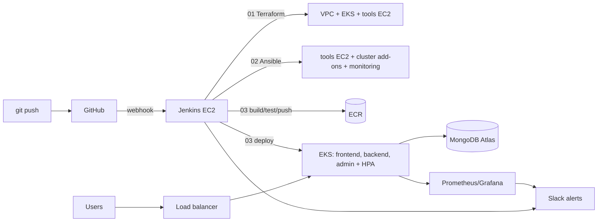

# End-to-End DevOps Pipeline for a Web Application with CI/CD

**ShopNow on AWS EKS — Jenkins · Terraform · Ansible · Docker · Kubernetes · Prometheus · Grafana**

Capstone project, completed individually by **Kamal Vasvani** (the brief assigned a 4-person group; all roles were performed by one person).
Repository forked from `suhailm67-sys/End-to-End-DevOps-Pipeline-for-a-Web-Application-with-CI-CD` (the original application README is preserved in [docs/ORIGINAL-APP-README.md](docs/ORIGINAL-APP-README.md)).

## What this project delivers

| Brief deliverable | Where |
| --- | --- |
| End-to-end Jenkins CI/CD pipeline (build, provisioning, configuration, deployment, testing, monitoring) | [docs/02-jenkins.md](docs/02-jenkins.md), `Jenkinsfile`, `jenkins/` |
| AWS infrastructure with Terraform (VPC, EKS, EC2, S3 state) | [docs/03-terraform.md](docs/03-terraform.md), `infra/` |
| Configuration management with Ansible | [docs/04-ansible.md](docs/04-ansible.md), `ansible/` |
| Scalable, resilient deployment on EKS | [docs/05-kubernetes.md](docs/05-kubernetes.md), `k8s/` |
| Monitoring and alerts (Prometheus, Grafana, Slack) | [docs/06-monitoring.md](docs/06-monitoring.md), `monitoring/` |
| Documentation: setup, usage, configuration, troubleshooting | this README + [docs/](docs/) |
| Sprint-by-sprint execution report | **[docs/SPRINT-REPORT.md](docs/SPRINT-REPORT.md)** |
| Test cases and results (T01–T14, all passed) | [docs/07-testing.md](docs/07-testing.md) |
| Cost optimisation and actual spend | [docs/08-cost.md](docs/08-cost.md) |

## Scope

The brief's deliverables list mentions a dashboard across AWS, Azure and GCP, while all six sprints specify AWS only. This project implements the AWS scope: Grafana for resource and application monitoring, AWS Cost Explorer and budget alerts for cost. Azure or GCP would be added to the same Grafana as further data sources (Azure Monitor, Google Cloud Monitoring); this is not implemented.

## Architecture in one picture

See [docs/architecture.md](docs/architecture.md) for the full diagram, design decisions and account constraints.



## Headline results

- **One click to a running platform:** an empty VPC to a deployed, monitored, smoke-tested application in **≈ 18 minutes** (Terraform → Ansible → deploy chained automatically, 53 resources).
- **Commit to production in ≈ 4 minutes:** a real defect (invoice downloaded as HTML) was fixed and delivered through the pipeline.
- **Zero-downtime safety:** a deliberately broken release was detected and rolled back automatically; the site answered HTTP 200 throughout.
- **Autoscaling proven:** backend scaled 2 → 4 pods at 114 % CPU and back to 2 when idle.
- **Monitoring caught a real fault:** a `TargetDown` alert fired in Slack for an unreachable exporter before it was noticed manually, and resolved after the fix.
- **Cost:** a full working day of the platform cost **≈ USD 1.25**; an idle day **≈ USD 0.14**. Total project spend is a few dollars against a USD 30 budget.

## Quick start (daily routine)

```bash
source .capstone-env                                   # AWS_PROFILE=capstone, JENKINS_ID, HOOK_ID
aws ec2 start-instances --instance-ids $JENKINS_ID     # start Jenkins (new public IP each start)
# update webhook to the new IP (docs/02-jenkins.md#webhook), then in Jenkins:
#   01-infra-terraform  ACTION=apply ENV=dev  -> 02-config-ansible -> 03-shopnow-cicd (automatic)
# ... work ...
#   99-nightly-destroy  (also runs automatically at 21:00 IST): destroys the platform and stops Jenkins
bash scripts/session-end-check.sh                      # verify nothing billable is left
```

## Repository map

| Path | Purpose |
| --- | --- |
| `frontend/`, `admin/`, `backend/` | ShopNow application (Dockerised; fixes listed in [docs/05-kubernetes.md](docs/05-kubernetes.md)) |
| `Jenkinsfile`, `jenkins/` | The four pipelines: `01-infra-terraform`, `02-config-ansible`, `03-shopnow-cicd`, `99-nightly-destroy` |
| `infra/bootstrap/` | Persistent layer: Jenkins EC2, IAM role, ECR (run once) |
| `infra/platform/` | Disposable layer: VPC, EKS, node group, tools EC2, peering (run by Jenkins) |
| `ansible/` | Playbooks and roles (Jenkins host, tools EC2, cluster add-ons) |
| `k8s/` | Deployments, Services, HPA, ServiceMonitor |
| `monitoring/` | Helm values, alert rules, Grafana dashboards |
| `tests/`, `scripts/` | Smoke test, infra check, pre-destroy cleanup, session helpers |
| `docs/` | All documentation, evidence screenshots (`docs/images/`) and command outputs (`docs/evidence/`) |
