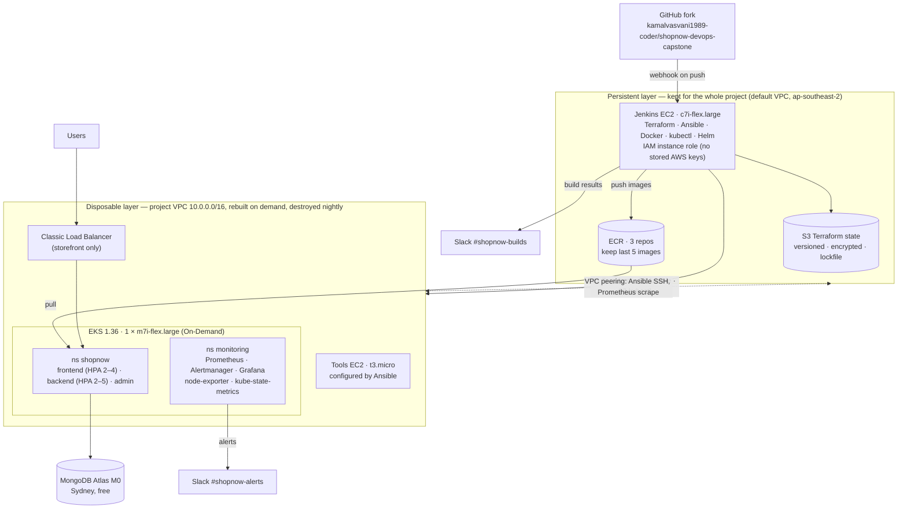

# Architecture

## Diagram

## Request flow

Browser → Classic Load Balancer → `frontend` pod (nginx serves the React build and proxies `/api/*`) → `backend-service:5000` (Node/Express) → MongoDB Atlas. The `admin` app (order management) has no public endpoint; it is reached with `kubectl port-forward` through the Kubernetes API.

## Two layers

| Layer | Contents | Lifetime | Created by |
| --- | --- | --- | --- |
| Persistent | Jenkins EC2, its IAM role and security group, ECR repositories, S3 state bucket | Whole project; Jenkins **stopped** when idle | `infra/bootstrap` (once, from the laptop) |
| Disposable | VPC, subnets, IGW, peering, EKS cluster + node group + add-ons, tools EC2, Grafana IAM role | Only while working; destroyed nightly at 21:00 IST | `infra/platform` via Jenkins job `01-infra-terraform` |

Jenkins must exist before it can run Terraform; that is why it lives in the persistent layer and reaches the project VPC through VPC peering.

## Design decisions and the production alternative

| Decision | Why (cost / simplicity) | Production alternative |
| --- | --- | --- |
| No NAT gateway; nodes in public subnets with tight security groups | Saves ≈ USD 1/day; previous work showed VPC/NAT/IPv4 costs nearly as much as EKS itself | Private subnets + NAT gateway or VPC endpoints |
| One load balancer (storefront only); admin, Grafana, Prometheus via `kubectl port-forward` | Each extra load balancer ≈ USD 0.60/day; internal tools not exposed | AWS Load Balancer Controller + one ALB with TLS, SSO in front of internal tools |
| One On-Demand worker node (m7i-flex.large, 8 GB, 29 pods) | Cheapest node that fits system + monitoring + app at peak (≈ 23 pods) | ≥ 2 nodes across AZs, Cluster Autoscaler / Karpenter |
| MongoDB Atlas M0 (external) | Free, survives every cluster rebuild | Dedicated Atlas tier / DocumentDB with private networking |
| Platform destroyed nightly, rebuilt in ≈ 18 min | Idle cost drops from ≈ USD 9/day to ≈ USD 0.14/day | Long-lived environments |
| Prometheus without persistent volume (2-day retention) | No EBS, no CSI driver | Amazon Managed Prometheus or persistent volumes |
| Jenkins role with AdministratorAccess (lab account, accepted risk) | Terraform must create IAM roles for EKS | Least-privilege role + permission boundary; Jenkins private behind VPN/SSO |
| EKS Pod Identity instead of IRSA | IRSA's OIDC provider is denied in this account (see constraints) | Either; Pod Identity is the newer approach |

## Account constraints and how the design adapted

The project ran in a personal AWS account on the **new Free plan**, governed by AWS Organizations service control policies (SCPs). Each restriction was discovered with evidence and turned into a design decision.

| Constraint (evidence) | Effect | Adaptation |
| --- | --- | --- |
| Region locked to **ap-southeast-2** (`explicit deny in a service control policy` for us-east-1) | All resources in Sydney | Every region reference switched to `ap-southeast-2` |
| **Spot instances denied** by SCP | No Spot nodes | `node_capacity = "ON_DEMAND"` |
| **Only Free-Tier-eligible instance types** (`InvalidParameterCombination: not eligible for Free Tier`) | t3.medium rejected | Jenkins `c7i-flex.large`, EKS node `m7i-flex.large`, tools `t3.micro` |
| `iam:CreateOpenIDConnectProvider` **denied** | IRSA impossible | `enable_irsa = false`; Grafana uses **EKS Pod Identity** |
| No CloudWatch billing metric on the Free plan | Grafana cost panel shows "No data" | Cost evidence from Cost Explorer + daily budget alert |
| EKS 1.33 in **extended support** (6× control-plane price) | Avoid USD 0.60/h | EKS **1.36** (standard support) |
