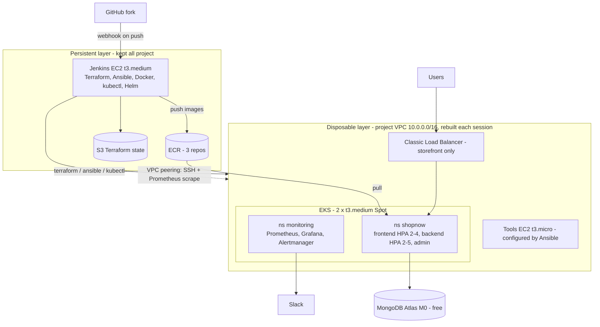

# Architecture

## Design decisions (and the production alternative)
| Decision | Saves | Production would use |
| --- | --- | --- |
| No NAT gateway; nodes in public subnets with tight security groups | ~$1.08/day | Private subnets + NAT gateway (or VPC endpoints) |
| One Classic LB for the storefront; admin/Grafana via `kubectl port-forward` | ~$0.60/day per extra LB | AWS Load Balancer Controller + one ALB with path/host rules and TLS |
| Spot worker nodes | ~2/3 of node cost | Mixed on-demand + Spot node groups, Cluster Autoscaler/Karpenter |
| MongoDB Atlas M0 | free; data survives teardown | Atlas dedicated tier / DocumentDB in private subnets with peering |
| Cluster destroyed every night | ~$2.40/day control plane | Long-lived clusters per environment |
| No Prometheus persistence (2-day retention) | EBS + EBS CSI driver | Amazon Managed Prometheus or persistent volumes |
| Jenkins with AdministratorAccess role (lab account) | setup time | Least-privilege role + permission boundary, private Jenkins behind VPN/SSO |
